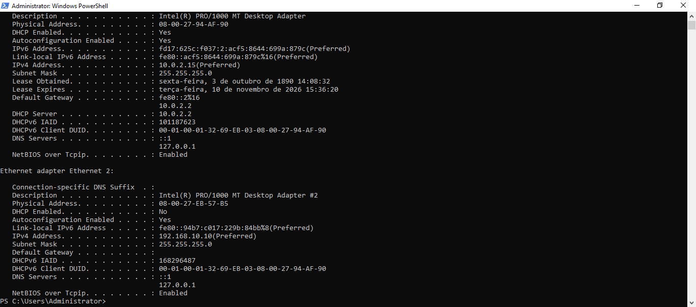
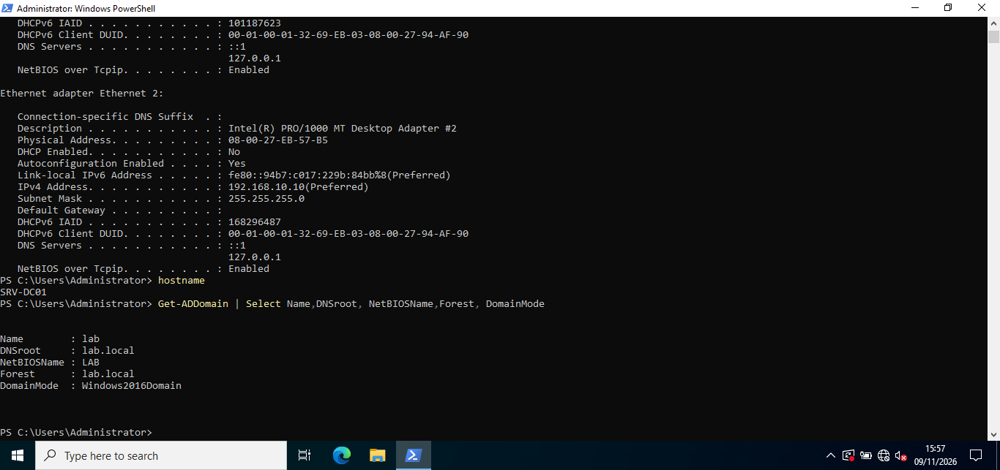
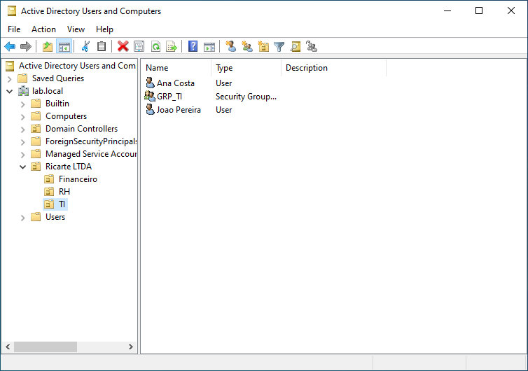
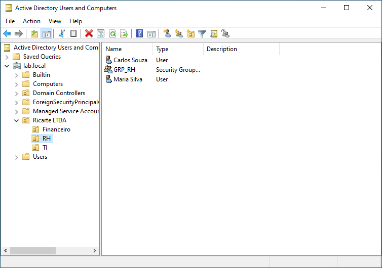
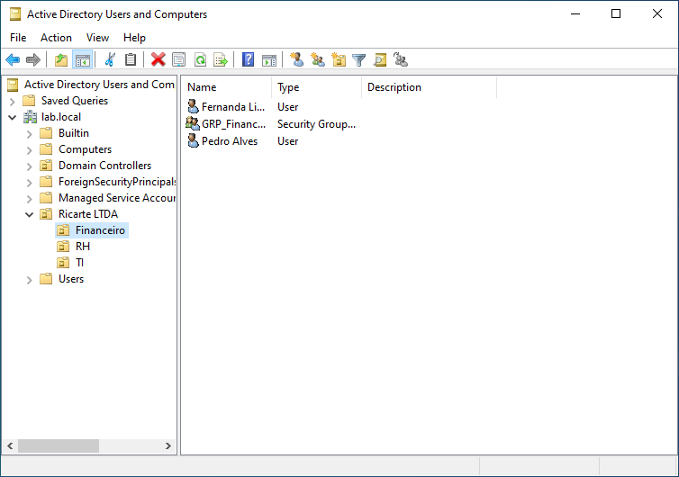
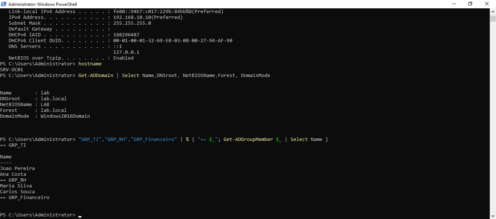
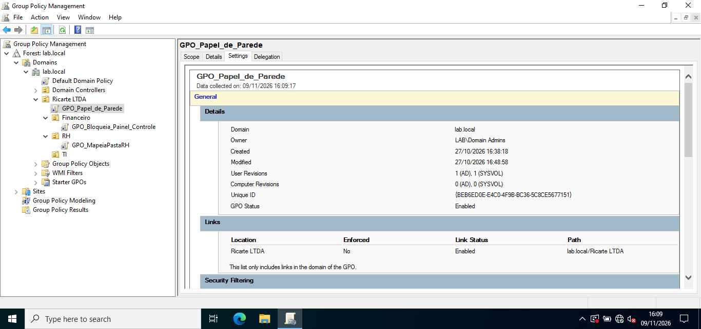
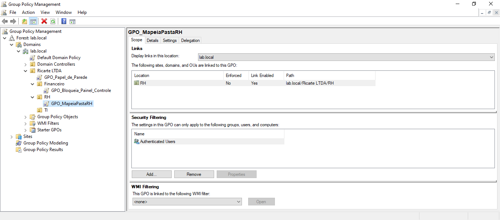
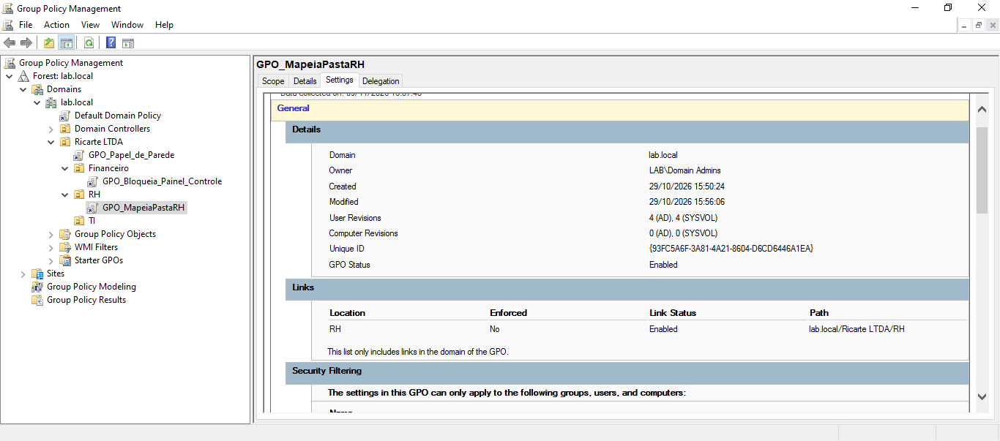
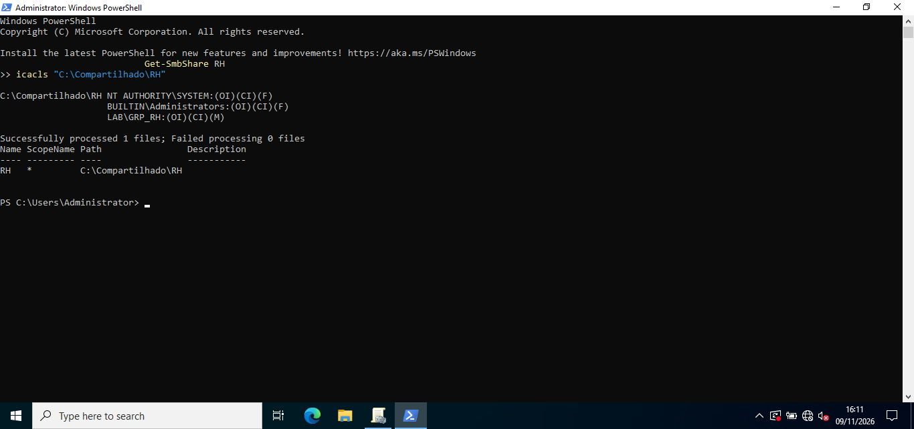

# Lab de Active Directory com Windows Server 2022

Montei esse lab no VirtualBox pra praticar Active Directory de verdade, com domínio, usuários, grupos e políticas rodando num ambiente só meu, onde eu posso errar e refazer sem derrubar nada de ninguém. Eu trabalho com suporte de TI e queria entender melhor o que acontece por trás do cadastro de usuário, das permissões e das GPOs.

Aqui está o passo a passo do que fiz, com os prints de cada etapa.

## O ambiente

| | |
|---|---|
| Virtualização | Oracle VirtualBox |
| Servidor | `SRV-DC01`, Windows Server 2022 Standard (versão de avaliação) |
| Cliente | `PC-CLIENTE01`, Windows 10 |
| Domínio | `lab.local` (NetBIOS: `LAB`), nível funcional Windows Server 2016 |
| Rede do servidor | IP fixo `192.168.10.10/24`, DNS apontando pra ele mesmo (`127.0.0.1`) |

O servidor tem duas placas de rede: uma em NAT, só pra ter internet, e outra com o IP fixo da rede do lab.

## Como ficou a estrutura do domínio

```
lab.local
└── Ricarte LTDA
    ├── TI          →  GRP_TI
    ├── RH          →  GRP_RH
    └── Financeiro  →  GRP_Financeiro
```

Cada OU tem dois usuários fictícios e um grupo de segurança do departamento.

## O que eu fiz

### 1. Rede do servidor

Antes de instalar o AD, deixei o servidor com IP fixo e o DNS apontando pra ele mesmo, que é o jeito certo de configurar o primeiro controlador de domínio. O `ipconfig /all` mostra as duas placas: a de NAT (`10.0.2.15`) e a do lab (`192.168.10.10`).



### 2. Domínio lab.local

Depois de promover o servidor a controlador de domínio, conferi tudo pelo PowerShell com o `Get-ADDomain`: nome do domínio, floresta e nível funcional.



### 3. OUs, usuários e grupos

Criei uma OU raiz chamada **Ricarte LTDA** (o nome da empresa fictícia) e, dentro dela, uma OU para cada departamento: TI, RH e Financeiro. Em cada uma coloquei dois usuários e um grupo de segurança, `GRP_TI`, `GRP_RH` e `GRP_Financeiro`.





Também listei os membros dos grupos com o `Get-ADGroupMember`, pra conferir pelo PowerShell o que eu tinha feito na interface.



### 4. GPOs

Criei três GPOs no Group Policy Management, cada uma ligada no lugar que faz sentido:

- **`GPO_Papel_de_Parede`**: vinculada na OU raiz **Ricarte LTDA**, então vale pra todas as OUs de baixo.
- **`GPO_Bloqueia_Painel_Controle`**: vinculada na OU **Financeiro**, bloqueando o acesso ao Painel de Controle.
- **`GPO_MapeiaPastaRH`**: vinculada na OU **RH**, pra mapear a pasta compartilhada do departamento.



Na `GPO_MapeiaPastaRH` dá pra ver o escopo: ela está vinculada só na OU RH e o filtro de segurança está no padrão (*Authenticated Users*).




### 5. Pasta compartilhada do RH

Criei a pasta `C:\Compartilhado\RH` e compartilhei com o nome `RH`. Na parte de permissões, em vez de dar acesso usuário por usuário, liberei só pro grupo `GRP_RH` (permissão de modificar), além de `SYSTEM` e `Administrators` com controle total. Quem entrar ou sair do RH é só mexer no grupo.



## O que eu tirei disso

- Dar permissão por **grupo** deixa tudo bem mais simples de manter do que mexer em usuário por usuário.
- Em GPO, o que mais importa é **onde ela está vinculada**: a mesma política se comporta de um jeito na OU raiz e de outro numa OU específica.
- Conferir pelo PowerShell o que eu fiz pela interface ajuda a pegar erro cedo.

## Próximos passos

- Ingressar o `PC-CLIENTE01` no domínio e validar as GPOs no lado do cliente (`gpupdate` e `gpresult`).
- Testar o acesso à pasta do RH com um usuário de outro departamento, pra confirmar que o acesso é negado.

## Ferramentas usadas

Oracle VirtualBox, Windows Server 2022, Active Directory Domain Services, Active Directory Users and Computers, Group Policy Management, PowerShell e `icacls`.

> Todos os nomes de usuários e a empresa "Ricarte LTDA" são fictícios. É um ambiente de estudo, isolado, sem nenhum dado real.
